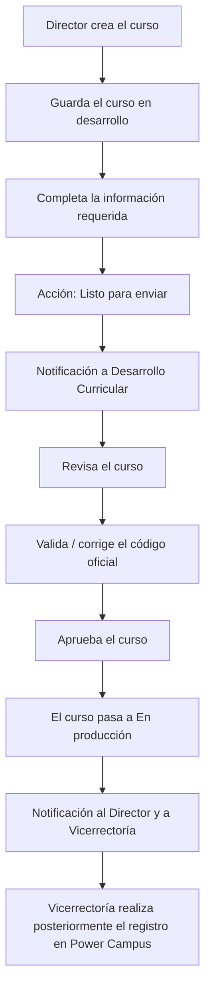
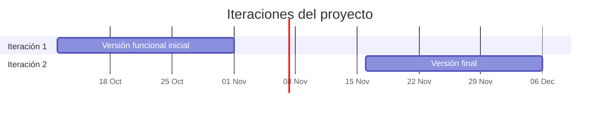

# 🎓 Sistema de Gestión de Cursos CENFOTEC

**Plataforma institucional para registrar, revisar, aprobar y consultar el catálogo de cursos de la Universidad CENFOTEC.**

> [!IMPORTANT]
> Este repositorio se encuentra en **etapa de planificación y especificación**. Todo lo descrito a continuación corresponde al **alcance previsto** del sistema, no a funcionalidad ya implementada.

---

## 📖 Descripción general

El **Sistema de Gestión de Cursos CENFOTEC** busca automatizar y centralizar el proceso mediante el cual la universidad registra, revisa, aprueba, consulta y administra los cursos que produce.

Actualmente parte de esa información se maneja mediante documentos, formularios y hojas de cálculo dispersas. El sistema pretende unificar ese proceso en una sola plataforma y mantener un **catálogo institucional e histórico** de cursos.

---

## ❗ Problema que busca resolver

| Situación actual | Consecuencia |
|---|---|
| Información distribuida en documentos, formularios y hojas de cálculo | Duplicidad y falta de una fuente única de verdad |
| Revisión y aprobación de cursos sin flujo formal en sistema | Trazabilidad limitada del estado de cada curso |
| Comunicación manual entre Direcciones, Desarrollo Curricular y Vicerrectoría | Retrasos y dependencia de avisos informales |
| Cursos descontinuados sin registro histórico estructurado | Pérdida de información institucional |

---

## 🎯 Objetivos del sistema

- Centralizar el registro y la administración de los cursos que produce la universidad.
- Formalizar el flujo de creación, revisión y aprobación de cursos.
- Mantener un catálogo institucional e histórico, sin eliminación física de registros.
- Controlar el acceso a la información según el rol de cada usuario.
- Notificar automáticamente a los responsables en los puntos clave del flujo.
- Facilitar la consulta de reportes institucionales e históricos.
- Ofrecer la interfaz en español e inglés, respetando la identidad visual institucional.

---

## 👥 Roles del sistema

Existen **cinco roles fijos y predefinidos**. Cada usuario posee exactamente un rol y **no existe auto-registro**: el Administrador registra a los usuarios.

| Rol | Responsabilidades previstas | Alcance de consulta |
|---|---|---|
| 🛠️ **Administrador** | Registra usuarios, asigna roles y administra catálogos | Acceso general al sistema |
| 📋 **Desarrollo Curricular** | Consulta cursos enviados a revisión, revisa la información, verifica y corrige el código oficial del curso, aprueba cursos | Cursos enviados a revisión |
| 🏫 **Director de Escuela / Carrera** | Registra cursos, los guarda en desarrollo, completa la información requerida y los envía a revisión | Únicamente los cursos de su escuela |
| 🏛️ **Rectoría** | Consulta información y reportes institucionales | Global e histórico, solo lectura |
| 🏢 **Vicerrectoría** | Consulta reportes globales e históricos; recibe la notificación de aprobación y luego realiza manualmente el registro en Power Campus | Global e histórico |

---

## 🔄 Flujo principal de gestión de cursos

El registro de un curso puede iniciarse con un mínimo de tres datos — **Escuela**, **Código del curso** y **Nombre del curso** — y guardarse mientras está en desarrollo. La acción **"Listo para enviar"** queda disponible cuando toda la información obligatoria esté completa.

---

## ✨ Principales funcionalidades previstas

### 🔐 Autenticación y usuarios
- Inicio de sesión mediante correo y contraseña.
- Inicio de sesión mediante cuenta institucional de Google.
- Registro de usuarios y asignación de roles a cargo del Administrador.

<strong>Reglas previstas para la contraseña</strong>

 

| Regla | Valor |
|---|---|
| Longitud | Entre 8 y 15 caracteres |
| Mayúsculas | Al menos una |
| Minúsculas | Al menos una |
| Números | Al menos uno |
| Almacenamiento | Las credenciales deben almacenarse de forma segura |

### 📚 Gestión de cursos
- Registro de cursos por parte del Director, con guardado en estado *En desarrollo*.
- Envío a revisión mediante la acción **"Listo para enviar"**.
- Revisión, validación del código oficial y aprobación por Desarrollo Curricular.
- Conservación histórica: los cursos **no se eliminan físicamente**; al dejar de ofrecerse se conservan como *Inactivo*.

<strong>Campos definidos del curso</strong>

 

| | | |
|---|---|---|
| Escuela | Código del curso | Nombre del curso |
| e-commerce abierto | Estado | Fecha de última modificación |
| Área SEFIA | Temática | Metodología de aprendizaje |
| Nombre en Power Campus | Número de créditos | Horas clase |
| Horas extra clase | Total de horas | Modalidad |
| Requisitos indispensables | Requisitos deseables | Moneda |
| Programa al que pertenece | Descripción corta | Meta descripción |
| Competencia | Capacidades específicas | Descripción larga |
| Nivel de complejidad | Perfil de ingreso | Perfil de salida |
| Palabras clave | Casa certificadora | Certificación |
| Metadata | Fecha de modificación de metadata | |

<strong>Validaciones y cálculos conocidos</strong>

 

| Regla | Detalle |
|---|---|
| Nombre en Power Campus | Máximo 40 caracteres |
| Descripción corta | Máximo 250 caracteres |
| Meta descripción | Máximo 155 caracteres |
| Total de horas | `Horas clase + Horas extra clase` |
| Nombre en Power Campus | La longitud debe calcularse dinámicamente |

**Modalidades permitidas:** Virtual en vivo · Presencial · Híbrida

**Niveles de complejidad:** Básico · Intermedio · Avanzado · Certificación · Nivel variable

### 🗂️ Catálogos
Administrados por el Administrador:

`Escuelas` · `Carreras` · `Estados de curso` · `Áreas SEFIA` · `Temáticas` · `Metodologías de aprendizaje` · `Niveles de complejidad` · `Casas certificadoras`

Se contempla **carga mediante CSV** para: Áreas SEFIA, Temáticas y Casas certificadoras.

### 🔔 Notificaciones

| Evento | Destinatarios |
|---|---|
| Un Director termina un curso y lo envía a revisión | Desarrollo Curricular |
| Desarrollo Curricular aprueba un curso | Director correspondiente y Vicerrectoría |

Canales contemplados: **correo electrónico** y **notificaciones del sistema operativo**. Los correos deben utilizar HTML, identidad visual institucional y comunicación formal.

### 📊 Reportes
- Catálogo/listado general de cursos.
- Reportes institucionales de producción de cursos.
- Información histórica y comparaciones entre períodos.
- Consultas por escuela/carrera y filtros sobre la información.

Rectoría, Vicerrectoría y Administración tienen acceso global según sus funciones. Los Directores únicamente pueden consultar la información correspondiente a su escuela.

---

## 🏷️ Estados de un curso

| Estado | Significado |
|---|---|
| `En desarrollo` | El curso está siendo registrado o completado por el Director |
| `En producción` | El curso fue aprobado por Desarrollo Curricular |
| `Inactivo` | El curso ya no se ofrece y se conserva históricamente |

> Los cursos no se eliminan físicamente en ningún caso.

---

## 🧰 Tecnologías / estrategia tecnológica

El desarrollo se plantea en dos iteraciones con alcances tecnológicos distintos.

### Iteración 1 — versión funcional inicial

| Elemento | Uso previsto |
|---|---|
| HTML semántico | Estructura de la interfaz |
| CSS responsive | Presentación y adaptabilidad |
| JavaScript nativo | Lógica del lado cliente |
| Validaciones del lado cliente | Reglas de formularios y cálculos |
| LocalStorage | Persistencia temporal |
| Notificaciones de escritorio | Avisos al usuario |

Alcance principal: registro, autenticación básica, roles, creación y modificación de cursos, validaciones, cálculos, consultas y elementos iniciales de interfaz.

### Iteración 2 — versión final

| Elemento | Uso previsto |
|---|---|
| Bootstrap | Componentes e interfaz |
| Node.js | Backend |
| MongoDB Atlas | Base de datos |
| Persistencia real y CRUD completo | Gestión de cursos y catálogos |
| Manejo de sesiones | Control de acceso |
| Google Authentication | Inicio de sesión institucional |
| Correos y notificaciones | Comunicación del flujo |
| Gemini | Sugerencias asistidas |
| Reportes y filtros | Consulta institucional e histórica |
| Python | Integración indicada en los requerimientos académicos de la Iteración 2; **su propósito exacto aún no está definido** |

---

## 🔌 Integraciones previstas

| Integración | Propósito |
|---|---|
| **Google Authentication** | Inicio de sesión mediante cuenta institucional de Google |
| **Gemini** | Asistencia y sugerencias al usuario |
| **Correo electrónico** | Notificaciones en HTML con identidad institucional |
| **Notificaciones del sistema operativo** | Avisos de escritorio |
| **Power Campus** | Registro realizado **manualmente** por Vicerrectoría tras la aprobación; no es una integración automática |
| **Python** | Integración requerida en la Iteración 2; propósito aún sin definir |

### Sobre Gemini

Gemini se contempla como **asistencia/sugerencia** sobre los siguientes campos:

- Metodología de aprendizaje
- Descripción corta
- Meta descripción
- Descripción larga

> [!NOTE]
> La **Competencia** no debe generarse mediante Gemini.

---

## 🗣️ Idiomas

| Idioma | Condición |
|---|---|
| Español | Predeterminado |
| Inglés | Disponible |

El cambio de idioma es manual. La interfaz debe respetar la identidad visual institucional de la Universidad CENFOTEC.

---

## 🧭 Metodología de trabajo

El proyecto se gestiona con **Scrum** sobre **Jira**.

| Concepto | Aplicación en el proyecto |
|---|---|
| **Epics** | 8 agrupaciones de alto nivel del alcance |
| **User Stories** | 24 historias que describen la necesidad desde la perspectiva del usuario |
| **Story Points** | Estimación relativa del esfuerzo de cada historia |
| **MoSCoW** | Priorización del backlog (Must / Should / Could / Won't) |
| **Sprints** | 2 iteraciones principales con objetivos definidos |

---

## 🗓️ Roadmap

| Iteración | Período | Objetivo |
|---|---|---|
| **Iteración 1** | 12 oct – 1 nov 2026 | Primera versión funcional con HTML, CSS, JavaScript nativo, validaciones del lado cliente, LocalStorage y notificaciones de escritorio |
| **Iteración 2** | 16 nov – 6 dic 2026 | Versión final con Bootstrap, Node.js, MongoDB Atlas, persistencia real, CRUD completo, sesiones, Google Authentication, correos, notificaciones, Gemini, integraciones requeridas y reportes con filtros |

---

## 👨‍💻 Equipo de desarrollo

| Integrante | Rol |
|---|---|
| Otoniel González | Soporte |
| Valentina Cristancho | Calidad |
| Sebastian Fernandez | Administración |

> Los roles específicos de Scrum aún no han sido asignados.

---

## 🚦 Estado actual del proyecto

El proyecto se encuentra en **planificación y especificación**, con la preparación del **Product Backlog** en curso.

| Ámbito | Estado |
|---|---|
| Definición de requerimientos | En elaboración |
| Product Backlog (Epics y User Stories) | En preparación |
| Estimación y priorización | En preparación |
| Implementación | No iniciada |

Ninguna de las funcionalidades descritas en este documento está implementada todavía.

---

## 🚫 Alcance excluido

- ❌ **Matrícula de estudiantes.**
- ❌ **Gestión de alumnos.**
- ❌ Registro automático en Power Campus: lo realiza Vicerrectoría de forma manual.
- ❌ Auto-registro de usuarios: las cuentas las crea el Administrador.
- ❌ Eliminación física de cursos: se conservan históricamente como inactivos.

---

## 📄 Documentación

Los documentos del proyecto se enlazarán en esta sección conforme se elaboren.

| Documento | Estado |
|---|---|
| ERS (Especificación de Requerimientos de Software) | Pendiente |
| Documento de Diseño 1 | Pendiente |
| Documento de Diseño 2 | Pendiente |
| Casos de prueba | Pendiente |
| Otros documentos | Pendiente |

---

Proyecto académico · **Universidad CENFOTEC** · 2026

