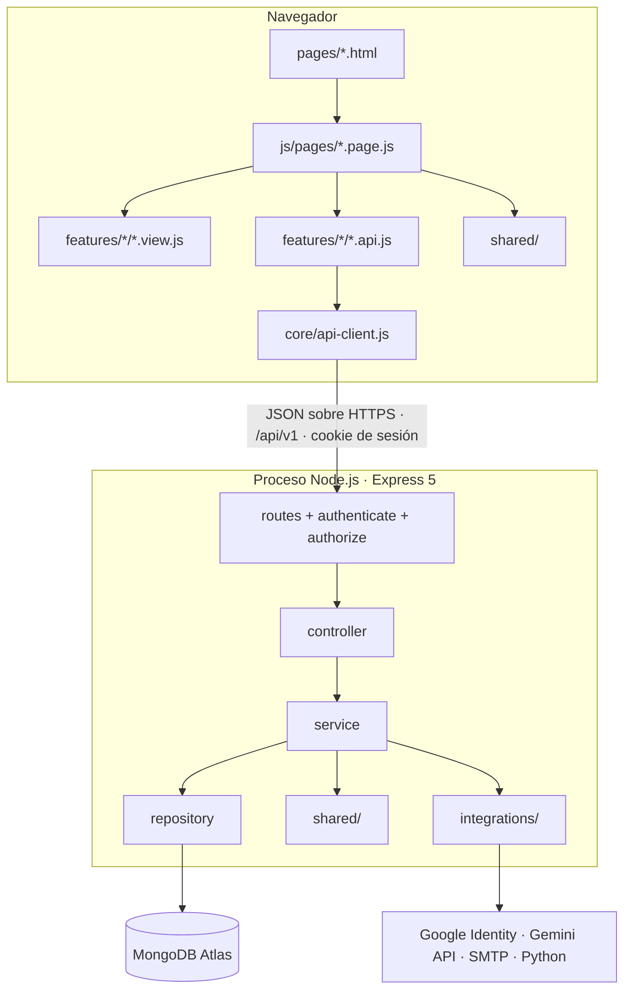
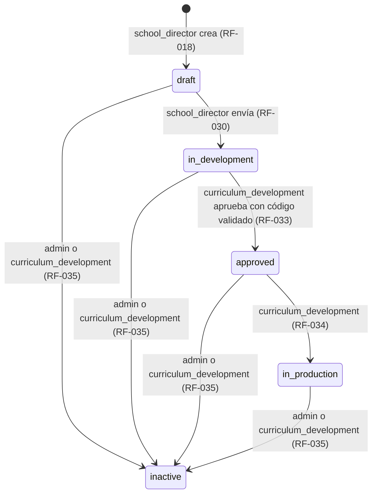

# 03 · Arquitectura del proyecto

> **Estado:** Vigente · **Versión:** 1.0.0 · **Última revisión:** 2026-11-14 · **Responsable:** equipo SGC

## 1. Propósito y alcance

Este documento define la arquitectura lógica y física del Sistema de Gestión de Cursos para la Iteración 2: capas, módulos, estructura de carpetas, dependencias permitidas entre piezas y el vocabulario de dominio que todo el código debe usar. Aplica a `frontend/`, `backend/`, `shared/`, `e2e/` y `docs/`.

No define reglas de estilo de código ([08 JavaScript](08-JAVASCRIPT.md)), contratos HTTP ([10 API REST](10-REST-API.md)), modelo de datos detallado ([11 MongoDB](11-MONGODB.md)) ni permisos ([13 Autenticación y autorización](13-AUTHENTICATION-AUTHORIZATION.md)); solo dónde vive cada cosa y quién puede depender de quién.

## 2. Estándar adoptado

| Elemento | Decisión | Estado |
|---|---|---|
| Estilo arquitectónico | **Monolito modular de tres capas**: presentación, servicio (negocio) y datos | Adoptado ([ADR-0002](../adr/0002-modular-monolith-three-layers.md)) |
| Separación por capas exigida | Capas de presentación, servicio y datos; módulos de autenticación, usuarios, catálogos, cursos, reportes e integraciones (RNF-045) | Confirmado (ERS) |
| Despliegue | Un solo proceso Node.js con Express sirve el frontend estático y la API `/api/v1` en el **mismo origen** | Adoptado |
| Frontend | Páginas HTML + ES Modules nativos, sin framework ni bundler; Bootstrap 5.3 | Adoptado ([ADR-0003](../adr/0003-frontend-mpa-es-modules-bootstrap.md)) |
| Persistencia | MongoDB Atlas con el driver oficial `mongodb` | Confirmado (ERS) / driver: Pendiente de validación ([ADR-0004](../adr/0004-mongodb-native-driver-json-schema.md), PV-01) |
| Código compartido | `shared/`: ES Modules puros usados por navegador y servidor (validaciones, constantes de dominio, normalización de texto) | Adoptado |
| Idioma de identificadores | Inglés, según el [Glosario de dominio](#glosario-de-dominio) | Adoptado ([ADR-0006](../adr/0006-english-identifiers-domain-glossary.md)) |

Las tres capas se aplican **dentro de cada módulo** (corte vertical): cada módulo de negocio tiene su propia ruta, controlador, servicio y repositorio.

## 3. Justificación

- **RNF-045** exige separar autenticación, usuarios, catálogos, cursos, reportes e integraciones en capas de presentación, servicio y datos. El corte por módulo permite que cada integrante trabaje en su carpeta con pocos conflictos de merge (la ERS §7.1 asigna un módulo por persona).
- **Un solo proceso y un solo origen** elimina CORS, simplifica la cookie de sesión (`SameSite=Lax`, sin dominios cruzados) y reduce la infraestructura a un único servicio desplegable, adecuado para tres personas y tres semanas.
- **Sin framework ni bundler** respeta la restricción del curso (HTML, CSS, JavaScript y Bootstrap) y evita una etapa de compilación que nadie del equipo mantiene.
- **`shared/`** garantiza que una regla (p. ej. "Nombre en Power Campus ≤ 40 caracteres", RN-17) se escriba una sola vez y se aplique igual en el navegador (experiencia de usuario) y en el servidor (seguridad, RNF-012).
- Un **monolito modular** se puede dividir después si fuera necesario; los microservicios no aportan nada con 5 000 cursos de prueba (RNF-019) y un único equipo.

## 4. Reglas

### 4.1 Obligatorias (DEBE)

| ID | Regla |
|---|---|
| ARC-01 | El código de servidor **DEBE** organizarse en las capas *routes → controller → service → repository*. Cada archivo pertenece a exactamente una capa, indicada por su sufijo (`.routes.js`, `.controller.js`, `.service.js`, `.repository.js`). |
| ARC-02 | Las dependencias **DEBEN** fluir solo hacia abajo según la [matriz de dependencias](#73-matriz-de-dependencias). Una capa nunca importa a una capa superior. |
| ARC-03 | Un controlador **NO DEBE** importar repositorios, el cliente de MongoDB ni integraciones externas; solo llama a servicios. |
| ARC-04 | Un servicio **NO DEBE** conocer `req`, `res`, `next`, cabeceras ni status HTTP; recibe datos planos y el usuario actuante (`actor`), y lanza `AppError` ([09](09-NODEJS-BACKEND.md)). |
| ARC-05 | Un repositorio **NO DEBE** contener reglas de negocio, permisos ni validaciones de dominio; solo consultas a MongoDB de su propio módulo. |
| ARC-06 | Un módulo **NO DEBE** importar el repositorio de otro módulo. La colaboración entre módulos se hace llamando funciones públicas del **servicio** del otro módulo. |
| ARC-07 | `shared/` **DEBE** ser JavaScript puro: sin DOM, sin `window`, sin `process`, sin módulos `node:*`, sin I/O. No importa nada de `frontend/` ni de `backend/`. |
| ARC-08 | `frontend/` y `backend/` **NO DEBEN** importarse entre sí. Lo único común es `shared/`. |
| ARC-09 | La API **DEBE** exponerse bajo `/api/v1` en el mismo proceso que sirve `frontend/` como raíz web. No se crean servidores, puertos ni orígenes adicionales. |
| ARC-10 | Las integraciones externas (Google Identity, Gemini, correo, Python) **DEBEN** encapsularse en `backend/src/integrations/`; ningún servicio llama directamente a un SDK externo. |
| ARC-11 | La configuración del entorno **DEBE** leerse únicamente en `backend/src/config/env.js` ([09](09-NODEJS-BACKEND.md)). Ningún otro archivo usa `process.env`. |
| ARC-12 | En el frontend, cada funcionalidad **DEBE** separar: `*.api.js` (HTTP), `*.view.js` (DOM) y `*.page.js` (orquestación). Las reglas puras van en `shared/` ([08](08-JAVASCRIPT.md)). |
| ARC-13 | Todo identificador de dominio (carpetas, archivos, variables, campos, rutas, colecciones, claves i18n) **DEBE** tomarse del [Glosario de dominio](#glosario-de-dominio). Un término nuevo se agrega al glosario en el mismo PR. |
| ARC-14 | Las carpetas nuevas **DEBEN** encajar en el [árbol objetivo](#72-estructura-objetivo). No se crean carpetas genéricas tipo `utils/`, `helpers/`, `misc/` o `common/` fuera de las previstas (`backend/src/lib/`, `frontend/js/core/`, `shared/`). |
| ARC-15 | Una dependencia npm nueva **DEBE** estar en el stack del [README §6](README.md#6-decisiones-clave) y del [ADR correspondiente](../adr/README.md); si no lo está, se justifica en el PR y se actualiza el estándar antes del merge. |
| ARC-16 | La autorización **DEBE** ejecutarse en el servidor (middleware de permiso + filtro de alcance en el servicio). Ocultar un botón en el frontend nunca sustituye esa verificación ([13](13-AUTHENTICATION-AUTHORIZATION.md)). |

### 4.2 Recomendadas (DEBERÍA)

| ID | Regla |
|---|---|
| ARC-17 | Un módulo **DEBERÍA** tener un único archivo por capa. Si un servicio supera ~300 líneas, se divide por subcaso de uso (p. ej. `course-workflow.service.js`), no por tipo técnico. |
| ARC-18 | Las dependencias de un servicio (repositorios, integraciones, reloj) **DEBERÍAN** recibirse por parámetro en su función de creación (`createCoursesService({ coursesRepository, notifications })`) para poder probarlo con dobles ([16](16-TESTING.md)). |
| ARC-19 | **NO DEBERÍAN** usarse archivos *barrel* (`index.js` que solo reexporta); generan ciclos de importación y ocultan dependencias. Se importa el archivo concreto. |
| ARC-20 | Los imports circulares **NO DEBERÍAN** existir. Si dos módulos se necesitan mutuamente, la lógica común pertenece a `shared/` (si es pura) o a un tercer servicio. |
| ARC-21 | El tamaño de una página HTML **DEBERÍA** corresponder a una pantalla del handoff (IDs `C-01`, `F-03`, etc.) y citarla en un comentario inicial, para la trazabilidad ([22](22-REQUIREMENTS-TRACEABILITY.md)). |

### 4.3 Opcionales (PUEDE)

| ID | Regla |
|---|---|
| ARC-22 | Un módulo **PUEDE** tener un archivo `<module>.schema.js` con el `$jsonSchema` de su colección y la lista blanca de campos editables ([11](11-MONGODB.md)). |
| ARC-23 | Un servicio **PUEDE** recibir una función `clock` inyectada (`() => new Date()`) para hacer deterministas las pruebas de fechas (RNF-027). |

## 5. Nomenclatura

| Elemento | Convención | Ejemplo |
|---|---|---|
| Carpetas y archivos | kebab-case, inglés, sin tildes ni espacios | `degree-programs/`, `course-list.page.js` |
| Archivos backend por capa | `<module>.<layer>.js` | `courses.routes.js`, `courses.controller.js`, `courses.service.js`, `courses.repository.js`, `courses.schema.js` |
| Subcasos de uso | `<module-subject>.<layer>.js` | `course-workflow.service.js`, `course-attachments.service.js` |
| Integraciones | `<servicio-externo>.js` | `gemini.js`, `google-identity.js`, `mailer.js`, `python-csv.js` |
| Frontend por funcionalidad | `features/<module>/<module>.api.js`, `<module>.view.js` | `features/courses/courses.api.js` |
| Entradas de página | `js/pages/<page>.page.js` ↔ `pages/<page>.html` | `pages/course-list.html` ↔ `js/pages/course-list.page.js` |
| Pruebas | `<archivo-probado>.test.js` | `courses.service.test.js` |
| Migraciones | `NNNN-<descripcion>.js` | `0001-create-collections.js` |
| Funciones de creación | `create<Nombre>` | `createCoursesService`, `createApp` |

Los nombres de colecciones, campos, roles y estados están en el [Glosario de dominio](#glosario-de-dominio).

## 6. Ejemplos

### 6.1 Correcto: cada capa hace solo su trabajo

```js
// backend/src/modules/courses/courses.controller.js — capa de presentación
export function createCoursesController(coursesService) {
  return {
    async submit(req, res) {
      const course = await coursesService.submit(req.params.courseId, req.user);
      res.json({ data: toCourseResponse(course) });
    },
  };
}
```

```js
// backend/src/modules/courses/course-workflow.service.js — capa de servicio
export function createCourseWorkflowService({ coursesRepository, notifications }) {
  return {
    async submit(courseId, actor) {
      const course = await coursesRepository.findById(courseId);
      // Reglas de negocio: alcance por escuela, estado y campos obligatorios (RF-030, RN-08).
      // ...
      return course;
    },
  };
}
```

### 6.2 Incorrecto: lógica de negocio y acceso a datos en la ruta

```js
// ❌ Ruta que valida, decide permisos y consulta MongoDB directamente
router.post('/courses/:id/submit', async (req, res) => {
  const course = await db.collection('courses').findOne({ _id: new ObjectId(req.params.id) });
  if (req.session.role !== 'school_director') return res.status(403).send('No');
  if (!course.topicId) return res.status(400).send('Falta temática');
  await db.collection('courses').updateOne({ _id: course._id }, { $set: { status: 'in_development' } });
  res.send('ok');
});
```

Problemas: viola ARC-01, ARC-03, ARC-04 y ARC-16 (el rol se lee de la sesión en vez del usuario cargado), no valida alcance por escuela (RF-009), no registra `statusHistory` ni `submittedAt`, no usa el formato de error de [10](10-REST-API.md) y no es atómico ante cambios concurrentes.

### 6.3 Incorrecto: módulo que usa el repositorio de otro

```js
// ❌ backend/src/modules/catalogs/catalogs.service.js
import { createCoursesRepository } from '../courses/courses.repository.js';
```

```js
// ✅ El servicio de catálogos recibe una función pública del servicio de cursos
export function createCatalogsService({ catalogsRepository, countCoursesUsingCatalogItem }) {
  // ...
}
```

## 7. Aplicación en el sistema CENFOTEC

### 7.1 Estado actual del repositorio (14 nov 2026)

```
.
├── .editorconfig · .prettierrc.json · .prettierignore · eslint.config.js   # Implementado (esta revisión; inactivos sin package.json)
├── README.md                                                               # Implementado (desactualizado frente a ERS v1.1)
├── backend/.gitkeep                                                        # Vacío: backend no iniciado
├── docs/  ERS v1.1 · ESTADO.md · casos de prueba y diseño It1 · standards/
├── frontend/
│   ├── index.html · pages/*.html      # Implementado (visual, sin JS): 59 páginas (docs/MATRIZ-COBERTURA-VISUAL.md)
│   ├── css/main.css                   # @layer vendor, tokens, base, layout, components, utilities
│   ├── css/{tokens,base,layout,components,utilities}/   # Tokens del DS y bloques BEM (D1 y D3 resueltas)
│   ├── vendor/bootstrap/ · fonts/     # Bootstrap 5.3.8 sin modificar (PV-04) · Barlow y Figtree (OFL)
│   └── img/                           # Logotipos oficiales e icons.svg (Lucide)
└── wireframes/                        # PNG 00–09 y herramienta figma-plugin-sgc (no es parte de la app)
```

No existen `package.json`, `shared/`, `backend/src/`, pruebas ni CI. La deuda está registrada en [18 §Deuda técnica](18-CODE-QUALITY.md#registro-de-deuda-técnica).

### 7.2 Estructura objetivo

Estado: **Adoptado**. Se crea de forma incremental; nadie crea carpetas vacías "para después".

```
/
├── package.json                 # raíz, "type": "module" (pendiente: tarea de arranque del backend)
├── frontend/                    # raíz web servida por Express
│   ├── index.html               # A-01 inicio de sesión
│   ├── pages/                   # una página HTML por vista: course-list.html, course-form.html…
│   ├── css/
│   │   ├── main.css             # orden de @layer e @import
│   │   ├── tokens/              # primitives, semantic, typography, spacing, elevation, bootstrap-variables (06, 07)
│   │   ├── base/  layout/  utilities/
│   │   └── components/          # un archivo por bloque BEM + bootstrap-components.css (07)
│   ├── fonts/                   # Barlow y Figtree autoalojadas (PV-04, 06)
│   ├── js/
│   │   ├── core/                # api-client.js, i18n.js, session.js, dom.js, notify.js
│   │   ├── features/<module>/   # <module>.api.js, <module>.view.js
│   │   └── pages/               # <page>.page.js (punto de entrada de cada HTML)
│   ├── i18n/                    # es.json, en.json
│   └── img/
├── shared/                      # ES Modules puros: validation/, domain/, text/
├── backend/
│   ├── src/
│   │   ├── server.js            # arranque: conexión a MongoDB y listen
│   │   ├── app.js               # composición de middlewares y módulos
│   │   ├── config/env.js        # único lector de process.env
│   │   ├── db/                  # client.js, migrate.js, seed.js, migrations/
│   │   ├── middlewares/         # request-id, verify-origin, error-handler…
│   │   ├── modules/<module>/    # routes, controller, service, repository, schema
│   │   ├── integrations/        # google-identity.js, gemini.js, mailer.js, python-csv.js
│   │   └── lib/                 # errors.js, logger.js, http-input.js
│   ├── scripts/python/          # Pendiente de validación (PV-06): procesamiento CSV
│   └── test/                    # unit/, integration/ (ver 16)
├── e2e/                         # Playwright (recomendado, PV-21)
└── docs/                        # standards/, adr/, api/openapi.yaml
```

Montajes estáticos de Express (raíz web = `frontend/`):

| URL | Carpeta | Nota |
|---|---|---|
| `/` | `frontend/` | `index.html` es A-01; las demás páginas en `/pages/<page>.html` |
| `/shared/` | `shared/` | El navegador importa `/shared/validation/course-rules.js` |
| `/vendor/bootstrap/` | `node_modules/bootstrap/dist/` (hoy: copia sin modificar en `frontend/vendor/bootstrap/`) | PV-04; Bootstrap nunca se modifica ([07](07-BOOTSTRAP.md)) |
| `/api/v1/` | routers de `backend/src/modules/` | API JSON ([10](10-REST-API.md)) |

Todas las referencias del frontend a recursos propios usan **rutas absolutas desde la raíz web** (`/css/main.css`, `/js/pages/course-list.page.js`). Esto corrige la mezcla actual de rutas relativas (`../css/main.css`) y absolutas (deuda D2).

### 7.3 Matriz de dependencias

Lectura: la fila **puede importar** a la columna (✅) o no (❌).

| Desde \ Hacia | routes | controller | service | repository | integrations | lib | shared | db/config |
|---|---|---|---|---|---|---|---|---|
| `app.js` (composición) | ✅ | ✅ | ✅ | ✅ | ✅ | ✅ | ✅ | ✅ |
| routes | — | ✅ | ❌ | ❌ | ❌ | ✅ | ❌ | ❌ |
| controller | ❌ | — | ✅ | ❌ | ❌ | ✅ | ✅ | ❌ |
| service | ❌ | ❌ | ✅ (otros módulos, solo servicio) | ✅ (propio) | ✅ | ✅ | ✅ | ❌ |
| repository | ❌ | ❌ | ❌ | — | ❌ | ✅ | ✅ | ✅ (cliente) |
| integrations | ❌ | ❌ | ❌ | ❌ | — | ✅ | ❌ | ✅ (config) |
| shared | ❌ | ❌ | ❌ | ❌ | ❌ | ❌ | ✅ | ❌ |

En el frontend: `*.page.js` → `*.api.js`, `*.view.js`, `core/`, `shared/`; `*.view.js` → `core/dom.js`, `core/i18n.js`, `shared/`; `*.api.js` → `core/api-client.js`. Una vista nunca llama a `fetch` y un `*.api.js` nunca toca el DOM.

### 7.4 Diagrama de capas



### 7.5 Módulos, carpetas y responsables

Responsables según `docs/ESTADO.md` §3 (Iteración 2). "Transversal" significa que todos lo usan y cualquier cambio requiere revisión del responsable.

| Módulo ERS | RF | Backend (`backend/src/…`) | Frontend (`frontend/js/…`) | Responsable |
|---|---|---|---|---|
| Autenticación | RF-001, RF-002 | `modules/auth/`, `integrations/google-identity.js` | `features/auth/`, `core/session.js` | Otoniel González |
| Usuarios y autorización | RF-003 a RF-009 | `modules/users/`, `modules/auth/permissions.js` | `features/users/` | Otoniel González (RF-008/009 transversal) |
| Catálogos e importación CSV | RF-010 a RF-017 | `modules/catalogs/`, `integrations/python-csv.js`, `scripts/python/` | `features/catalogs/` | Valentina Cristancho |
| Cursos | RF-018 a RF-027 | `modules/courses/` (`courses.*`, `course-attachments.service.js`) | `features/courses/` | Sebastián Fernández |
| Asistencia de redacción con IA | RF-028, RF-029 | `modules/courses/course-ai.service.js`, `integrations/gemini.js` | `features/courses/course-ai.view.js` | Otoniel González |
| Flujo de aprobación | RF-030 a RF-035 | `modules/courses/course-workflow.service.js` | `features/review/` | Otoniel (RF-030, 033, 034) · Sebastián (RF-031, 032, 035) |
| Notificaciones | RF-036 a RF-038 | `modules/notifications/`, `integrations/mailer.js` | `features/notifications/` | Otoniel (RF-036) · Valentina (RF-037, RF-038) |
| Consulta de cursos | RF-039 a RF-041 | `modules/courses/` | `features/courses/` | Sebastián Fernández |
| Reportes | RF-042, RF-043 | `modules/reports/` | `features/reports/` | Sebastián Fernández |
| Internacionalización | RF-044 | `modules/users/` (preferencia), plantillas de correo | `core/i18n.js`, `i18n/` | Valentina Cristancho |
| Infraestructura común | RNF-045, RNF-046 | `app.js`, `config/`, `db/`, `middlewares/`, `lib/` | `core/`, `css/tokens/`, `css/base/` | Transversal |

## 8. Errores frecuentes

- Poner consultas a MongoDB en el controlador "porque es una sola línea" (ARC-03).
- Pasar `req` completo al servicio y leer `req.body` dentro de él (ARC-04).
- Filtrar los cursos del Director en el frontend y confiar en que el servidor recibe el `schoolId` correcto en la query (ARC-16; el alcance se calcula del usuario autenticado).
- Crear `backend/src/utils/helpers.js` con funciones sin relación entre sí (ARC-14).
- Duplicar la misma validación en el navegador y en el servidor con código distinto en vez de usar `shared/` (ARC-07, ARC-12).
- Usar nombres en español o traducciones distintas del glosario (`curso`, `career`, `inReview`) (ARC-13).
- Importar un SDK externo directamente desde un servicio (ARC-10).
- Rutas relativas mezcladas en HTML (`../css/main.css`) que dejan de funcionar al mover una página.

## 9. Checklist

- [ ] Cada archivo nuevo de backend tiene sufijo de capa y vive en `modules/<module>/`, `integrations/`, `middlewares/`, `lib/`, `config/` o `db/`.
- [ ] Ningún controlador importa un repositorio, `mongodb` ni `integrations/`.
- [ ] Ningún servicio importa `express` ni usa `req`/`res`.
- [ ] Ningún módulo importa el repositorio de otro módulo.
- [ ] `shared/` no usa `window`, `document`, `process` ni `node:*`.
- [ ] `process.env` aparece solo en `backend/src/config/env.js`.
- [ ] Las páginas nuevas siguen el par `pages/<page>.html` ↔ `js/pages/<page>.page.js` y usan rutas absolutas.
- [ ] Los identificadores nuevos están en el glosario (o se agregaron en este PR).
- [ ] Toda acción protegida tiene `authorize(...)` en la ruta y filtro de alcance en el servicio.
- [ ] Las dependencias nuevas están justificadas y reflejadas en el estándar.

## 10. Referencias

- ERS v1.1, RNF-045 (Modularidad del código) y §7.1 (Restricciones técnicas).
- [ADR-0002 Monolito modular de tres capas](../adr/0002-modular-monolith-three-layers.md), [ADR-0003 Frontend MPA](../adr/0003-frontend-mpa-es-modules-bootstrap.md), [ADR-0006 Identificadores en inglés](../adr/0006-english-identifiers-domain-glossary.md).
- Express 5 — Migración y guía: https://expressjs.com/en/guide/migrating-5.html
- Node.js — Documentación de la API: https://nodejs.org/docs/latest/api/
- MDN — JavaScript modules: https://developer.mozilla.org/en-US/docs/Web/JavaScript/Guide/Modules
- ADR (Nygard): https://adr.github.io/

## Glosario de dominio

Estado: **Adoptado** ([ADR-0006](../adr/0006-english-identifiers-domain-glossary.md)). Es la tabla de traducción obligatoria entre la ERS (español) y el código (inglés). Los textos visibles al usuario no salen de aquí sino de los diccionarios i18n ([20](20-INTERNATIONALIZATION.md)).

### Entidades

| ERS (español) | Identificador | Colección MongoDB | Ruta API |
|---|---|---|---|
| Usuario | `user` | `users` | `/api/v1/users` |
| Rol | `role` | (valor en `users.role`) | — |
| Escuela | `school` | `schools` | `/api/v1/catalogs/schools` |
| Carrera | `degreeProgram` | `degreePrograms` | `/api/v1/catalogs/degree-programs` |
| Curso | `course` | `courses` | `/api/v1/courses` |
| Catálogo | `catalog` | (una colección por catálogo) | `/api/v1/catalogs/{catalogKey}` |
| Elemento de catálogo | `catalogItem` | — | — |
| Área SFIA | `sfiaArea` | `sfiaAreas` | `/api/v1/catalogs/sfia-areas` |
| Temática | `topic` | `topics` | `/api/v1/catalogs/topics` |
| Metodología de aprendizaje | `learningMethodology` | `learningMethodologies` | `/api/v1/catalogs/learning-methodologies` |
| Nivel de complejidad | `complexityLevel` | (catálogo fijo en código) | `/api/v1/catalogs/complexity-levels` |
| Casa certificadora | `certifyingBody` | `certifyingBodies` | `/api/v1/catalogs/certifying-bodies` |
| Certificación | `certification` | `certifications` | `/api/v1/catalogs/certifications` |
| Moneda | `currency` | (catálogo fijo en código) | `/api/v1/catalogs/currencies` |
| Modalidad | `modality` | (catálogo fijo en código) | `/api/v1/catalogs/modalities` |
| Estado de curso | `courseStatus` | (catálogo fijo en código) | `/api/v1/catalogs/course-statuses` |
| Adjunto | `attachment` | GridFS bucket `files` | `/api/v1/courses/{courseId}/attachments` |
| Bandeja de revisión | `reviewInbox` | (consulta sobre `courses`) | `/api/v1/review-inbox` |
| Aviso / notificación | `notification` | — | `/api/v1/notifications/stream` |
| Reporte | `report` | (agregaciones sobre `courses`) | `/api/v1/reports/...` |
| Importación CSV | `catalogImport` | — | `/api/v1/catalogs/{catalogKey}/imports` |

### Roles

Valores fijos (RN-02); cada usuario tiene exactamente uno (RN-01).

| Rol ERS | Actor | Valor almacenado | Único (RN-03) | Alcance |
|---|---|---|---|---|
| Administrador | ACT-01 | `admin` | Sí | Global |
| Desarrollo Curricular | ACT-02 | `curriculum_development` | No | Global (sin usuarios ni catálogos) |
| Director de Escuela | ACT-03 | `school_director` | No (uno por escuela) | Su escuela (RN-06) |
| Rectoría | ACT-04 | `rector` | Sí | Global, solo lectura |
| Vicerrectoría | ACT-05 | `vice_rector` | Sí | Global, solo lectura |

### Estados del curso y transiciones

| Estado ERS | Valor | Significado (ERS §1.3) |
|---|---|---|
| Borrador | `draft` | El Director lo completa; editable por el Director |
| En desarrollo | `in_development` | Enviado y en revisión de Desarrollo Curricular; el Director ya no lo edita |
| Aprobado | `approved` | Aprobado; pendiente de transcribirse y ofertarse |
| En producción | `in_production` | Se oferta |
| Inactivo | `inactive` | Dejó de impartirse; se conserva (eliminación lógica, RN-12) |

| Acción (identificador) | Transición | Ejecuta | Condición | Requerimiento |
|---|---|---|---|---|
| `create` | — → `draft` | `school_director` | Escuela (del perfil), nombre y código o `codeRequested` | RF-018, RN-07 |
| `submit` | `draft` → `in_development` | `school_director` | Todos los campos obligatorios válidos | RF-030, RN-08, RN-09 |
| `approve` | `in_development` → `approved` | `curriculum_development` | `codeValidated === true` | RF-033, RN-10, RN-11 |
| `moveToProduction` | `approved` → `in_production` | `curriculum_development` | — | RF-034, RN-11 |
| `deactivate` | cualquier estado ≠ `inactive` → `inactive` | `admin`, `curriculum_development` | Confirmación del usuario | RF-035, RN-12 |

No existe transición de devolución al Director (PV-14, [README §7](README.md#7-decisiones-pendientes-de-validación)).



### Catálogos fijos

| Catálogo | Valor ERS | Valor almacenado |
|---|---|---|
| Modalidad (RN-14) | Presencial | `in_person` |
| | Virtual sincrónica | `online_synchronous` |
| | Virtual asincrónica | `online_asynchronous` |
| | Híbrida | `hybrid` |
| Nivel de complejidad (RN-15) | Básico | `basic` |
| | Intermedio | `intermediate` |
| | Avanzado | `advanced` |
| | Certificación | `certification` |
| | Nivel variable | `variable` |
| Moneda (RF-014, ISO 4217) | Colones | `CRC` |
| | Dólares | `USD` |

### Campos del curso

"Borrador" indica si el campo se exige para guardar; "Envío" si se exige para "Listo para enviar" (Apéndice B). "Sistema" = lo calcula o asigna el servidor; nunca se acepta del cliente.

| Campo ERS | Identificador | Tipo | Borrador | Envío | Regla |
|---|---|---|---|---|---|
| Escuela | `schoolId` | ObjectId | Sí (del perfil del Director) | Sí | RF-009 CA2 |
| Código del curso | `code` | string | Sí, salvo `codeRequested` | Sí, salvo `codeRequested` | `PREFIJO-NÚMERO`, único (RF-018 CA3, PV-08) |
| Solicitar código a Desarrollo Curricular | `codeRequested` | boolean | No | No | RF-018 CA2 |
| Código validado | `codeValidated` | boolean | Sistema | Sistema | RF-032 CA1, RN-10 |
| Nombre del curso | `name` | string | Sí | Sí | Mínimo 3 caracteres |
| Estado | `status` | enum | Sistema | Sistema | Ver estados |
| Fecha de última modificación | `updatedAt` | Date | Sistema | Sistema | RN-26, RNF-027 |
| Área SFIA | `sfiaAreaId` | ObjectId | No | No | Opcional (RN-21) |
| Temática | `topicId` | ObjectId | No | Sí | RF-020 CA3 |
| Metodología de aprendizaje | `learningMethodologyId` | ObjectId | No | Sí | RF-020; PV-11 |
| Nombre en Power Campus | `powerCampusName` | string | No | Sí | ≤ 40 caracteres (RN-17) |
| Créditos | `credits` | int | No | Sí | 1 a 12 (RF-021 CA1) |
| Horas clase | `classHours` | int | No | Sí | 0 a 300 (RF-021 CA2) |
| Horas extra clase | `extraClassHours` | int | No | Sí | 0 a 300 (RF-021 CA2) |
| Total de horas | `totalHours` | int calculado | Sistema | Sistema | `classHours + extraClassHours` (RN-16); no se persiste |
| Modalidad | `modality` | enum | No | Sí | RN-14 |
| Requisitos indispensables | `requiredPrerequisites` | string | No | Sí | RF-023 |
| Requisitos deseables | `desiredPrerequisites` | string | No | Sí | RF-023 |
| Pertenece a un programa | `belongsToProgram` | boolean | No | Sí | RF-025 CA3 |
| Nombre del programa | `programName` | string | No | Sí, si `belongsToProgram` | RF-025 CA3 |
| Descripción corta | `shortDescription` | string | No | Sí | ≤ 250 (RN-18); Gemini |
| Meta descripción | `metaDescription` | string | No | Sí | ≤ 155 (RN-19); Gemini |
| Descripción larga | `longDescription` | string | No | Sí | Gemini (RF-028) |
| Competencia | `competency` | string | No | Sí | Sin Gemini (RN-22) |
| Capacidades específicas | `specificCapabilities` | string | No | Sí | RF-024 |
| Nivel de complejidad | `complexityLevel` | enum | No | Sí | RN-15 |
| Perfil de ingreso | `entryProfile` | string | No | Sí | RF-024 |
| Perfil de salida | `exitProfile` | string | No | Sí | RF-024 |
| Palabras clave | `keywords` | string[] | No | Sí (≥ 1) | Sin duplicados (RF-023 CA3) |
| Certificación | `certificationId` | ObjectId | No | Sí | Incluye el elemento de sistema "No tiene" (RN-25) |
| Casa certificadora | `certifyingBodyId` | ObjectId | No | Sí, si la certificación ≠ "No tiene" | RN-25 |
| Moneda | `currency` | enum | No | Sin definir en Apéndice B | RF-014 |
| E-commerce abierto | `ecommerce.isOpen` | boolean | No | Sí | RF-026 CA1 |
| Período de e-commerce | `ecommerce.startDate`, `ecommerce.endDate` | Date | No | Sí, si `isOpen` | `endDate ≥ startDate` |
| Metadata | `metadata` | string | No | Sí | Texto (PV-09) |
| Fecha de modificación de metadata | `metadataUpdatedAt` | Date | Sistema | Sistema | Solo cambia si cambia `metadata` (RF-026 CA2) |
| Adjuntos | `attachments` | array | No | No | `.doc`, `.docx`, `.pdf` ≤ 10 MB (RN-28) |
| Historial de estados | `statusHistory` | array | Sistema | Sistema | `{ from, to, by, at }` |
| Historial de código | `codeHistory` | array | Sistema | Sistema | Quién y cuándo (RF-032 CA2) |
| Auditoría | `createdBy`, `createdAt`, `submittedAt`, `approvedAt`, `approvedBy`, `productionAt`, `deactivatedAt`, `deactivatedBy` | ObjectId / Date | Sistema | Sistema | RF-033 CA1, RF-034 CA1, RF-043 |
| Texto de búsqueda | `searchText` | string | Sistema | Sistema | Normalizado sin tildes ni mayúsculas ([11](11-MONGODB.md)) |

### Campos del usuario

| Campo ERS | Identificador | Tipo | Obligatorio | Regla |
|---|---|---|---|---|
| Nombre | `firstName` | string | Sí | RF-003 CA1 |
| Apellidos | `lastName` | string | Sí | RF-003 CA1 |
| Identificación | `nationalId` | string | Sí | 9 a 12 dígitos, única (RF-003 CA1-CA2) |
| Correo institucional | `email` | string | Sí | `@ucenfotec.ac.cr`, único, en minúsculas |
| Correo personal | `personalEmail` | string | No | RF-003 CA1 |
| Celular | `phone` | string | Sí | 8 dígitos |
| Fecha de nacimiento | `birthDate` | Date | Sí | Edad 18 a 100 calculada, no persistida (RF-003 CA4) |
| Sexo | `sex` | enum | Sí | Opciones sin definir (PV-12) |
| Fotografía | `photoFileId` | ObjectId (GridFS) | No | PNG, JPG o WEBP ≤ 500 KB (RN-20) |
| Rol | `role` | enum | Sí | Ver roles |
| Escuela | `schoolId` | ObjectId | Solo `school_director` | RF-004 CA3; PV-07 |
| Contraseña | `passwordHash` | string | Sí al registrar | Nunca se expone ([12](12-SECURITY.md)) |
| Idioma preferido | `preferredLanguage` | `es` \| `en` | No (default `es`) | RF-044 CA3; PV-20 |
| Auditoría | `createdAt`, `updatedAt` | Date | Sistema | — |
